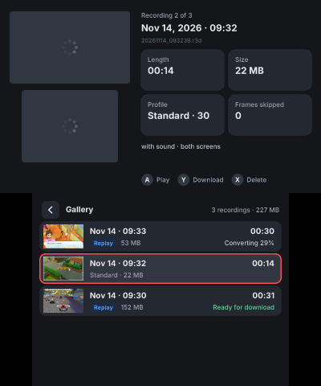
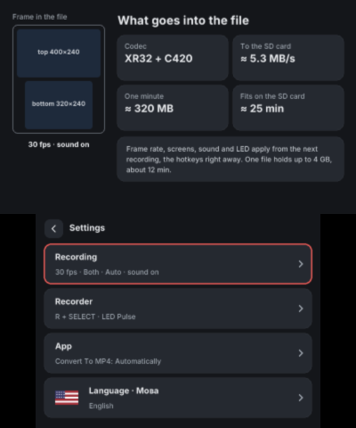
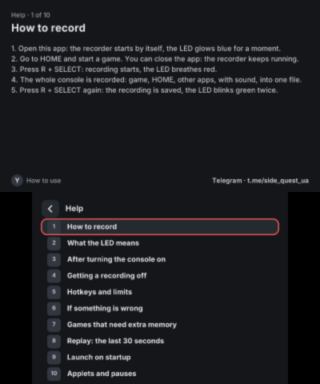
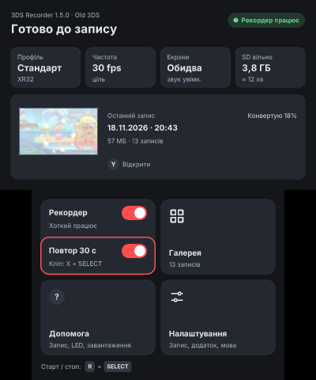
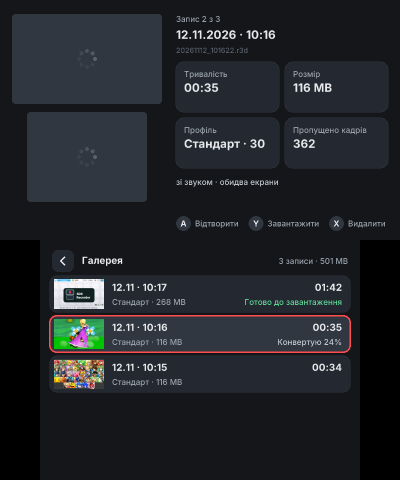
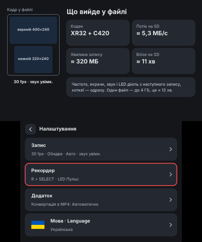
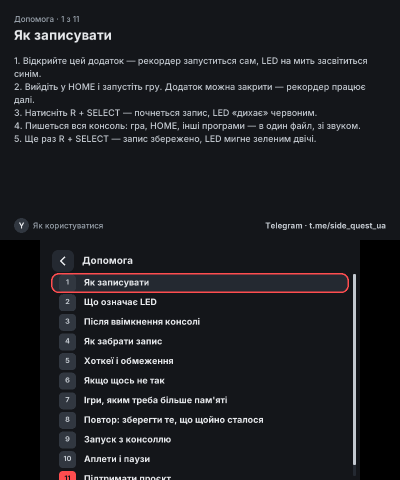

<h1 align="center">3DS Recorder</h1>

<p align="center">
  Record everything on your Nintendo 3DS — games, the HOME Menu and apps, both screens with sound.<br>
  Made in Ukraine 🇺🇦
</p>

<p align="center">
  <a href="#english"><b>English</b></a> · <a href="#ukrainian"><b>Українська</b></a>
</p>

<p align="center">
  
  
  
</p>

### Demo

<!-- the demo video: docs/demo.mp4 (kept locally), uploaded as a GitHub attachment -->

https://github.com/user-attachments/assets/122e7c76-d4c6-4f60-9426-aeed7d322776

*Recorded on an Old 3DS with 3DS Recorder itself: Mario Kart 7, both screens with sound. This is the MP4 the console
made, as it is (400 × 480), only cut shorter.*

More recordings, as they came out:

- [Old 3DS — HOME Menu and a Mario Kart 7 race](https://github.com/BolgarMaxym97/3ds-recorder/releases/download/v1.0.0/demo-old3ds-mk7.mp4) (2 min 19 s, 32 MB): the full
  video the clip above is cut from.
- [New 3DS XL — Resident Evil Revelations](https://github.com/BolgarMaxym97/3ds-recorder/releases/download/v1.0.0/demo-new3ds-re-revelations.mp4) (55 s, 11 MB): sent in
  by a tester; the recording was turned into MP4 on a computer with `tools/r3d2mp4.sh`.

---

<a id="english"></a>

## English

### What it is

3DS Recorder records the whole console: whatever is on the screens, in any game, the HOME Menu or a system app, with
the game sound. Press a button combination to start, press it again to stop — the video is saved to the SD card.
With **Replay** on, it also keeps the last 30 seconds of what you play all the time, so a moment that has already
happened can still be saved as a clip.

You do not need a PC or a capture card. The console turns each recording into a small MP4 video by itself, and you can
send it to your phone over Wi-Fi by scanning a QR code.

### What you need

- A Nintendo 3DS, 3DS XL, 2DS, New 3DS, New 3DS XL or New 2DS XL with **Luma3DS** custom firmware.
- **FBI** to install the `.cia` (or the Homebrew Launcher for the `.3dsx`).
- Free space on the SD card: up to **~320 MB per minute** in 3D games (both screens, 30 fps; menus and 2D games take much less). The MP4 made from it is about 25 MB a minute. Replay needs 700 MB free to switch on.
- To get videos on your phone: the phone and the console on the same Wi-Fi network (the console uses 2.4 GHz).

### Install

The newest version is always on the [Releases page](https://github.com/BolgarMaxym97/3ds-recorder/releases/latest): each release has `3ds-recorder.cia` and
`3ds-recorder.3dsx` under **Assets**. You need only one of them: the `.cia` puts an icon in the HOME Menu, the `.3dsx`
runs from the Homebrew Launcher.

1. Download `3ds-recorder.cia` (or `3ds-recorder.3dsx`) from the [latest release](https://github.com/BolgarMaxym97/3ds-recorder/releases/latest).
2. Copy it to the SD card. Install the `.cia` with FBI: SD → the file → **Install CIA**. The `.3dsx` needs no
   install: put it in the `/3ds/` folder.
3. Turn the console on while holding **SELECT** to open the Luma menu. Turn on
   **Enable loading external FIRMs and modules** and save with **START**.
4. Open **3DS Recorder**, choose your language and read the short guide. The recorder starts by itself: the
   notification LED glows blue for a moment.

**To update,** install the new `.cia` over the old one (or replace the `.3dsx`) and open the app: it updates the
recorder by itself. Settings and recordings stay.

### How to use

- **Start / stop a recording:** **R + SELECT**, anywhere — in a game, in the HOME Menu, in an app.
  You can close 3DS Recorder: the recorder keeps running in the background.
- **Replay — the last 30 seconds** (from version 1.1): switch **Replay 30 s** on in the Recorder tile. While a
  game or another program runs, the recorder keeps its last 30 seconds all the time (the LED glows faint blue; it begins about 15 seconds after
  a game starts, so the game loads undisturbed);
  press **X + SELECT** and they become a clip. Open 3DS Recorder afterwards: each clip turns up in the Gallery,
  marked *Replay*, within a minute or so. R + SELECT still starts a normal recording; Replay pauses meanwhile and
  goes on after it. See [Good to know](#good-to-know) for what it costs.
- **The LED tells you what is happening:**
  - blue for a moment — the recorder is ready;
  - red, breathing — recording;
  - faint blue, steady — Replay is keeping the last 30 seconds;
  - green twice — the recording or the clip is saved;
  - red three times — something went wrong (usually a full SD card); open the app to see why.
- **After each power-on, open 3DS Recorder once** — that starts the recorder again. Or let it start by itself:
- **Launch On Startup** (from version 1.2, off at first): Settings → **Launch On Startup**. The recorder then starts
  with the console each time it is turned on or restarts, with Replay as you left it, and you never have to open
  the app for it. It needs one more Luma option, **Enable game patching** (the same SELECT menu as at install);
  the app says so if it is off. See [Good to know](#good-to-know) for how it works and how to undo it.
- **Watch:** open the Gallery and press **A**.
- **Get the video on your phone:** in the Gallery press **Y** on a recording, scan the QR code with the phone's camera
  and tap **Save the video**. Nothing to install on the phone; iPhone and Android both work.
- **Or take it from the SD card:** recordings are in `/3ds/recorder/recordings/`. Next to each recording
  (`.r3d`) the console makes an `.mp4` that plays anywhere.
- **Settings:** frame rate (15 / 20 / 30 fps), both screens, the top one or the bottom one only, quality, sound on or off, the LED,
  the language and the two button combinations (**Hotkeys**: first the one for recordings, then the one that saves a
  Replay clip).
- **Quality:** with **Auto** a picture that changes all over (a 3D game in motion) is stored the way video is, colour at half
  the resolution, so both screens keep up to 30 frames a second on an Old 3DS; menus, 2D games and still pictures stay exact.
  **Lossless** keeps every frame exact; in 3D games the SD card then cannot take every frame and the video is less smooth.

<p align="center">
  
  
  
</p>

### Good to know

- **Leaving System Settings, starting a DS or GBA game, or turning the console off restarts the console.** The
  recording is saved and stops there; open 3DS Recorder again afterwards (with Launch On Startup the recorder is
  back by itself). The app tells you what happened.
- **Launch On Startup:**
  - the recorder adds one small file for Luma to the SD card (`/luma/titles/<system title>/exheader.bin`), which
    makes the console start the recorder together with its own system modules. Nothing in the console's own memory
    is changed, and Luma reads the file only with **Enable game patching** and **Enable loading external FIRMs
    and modules** on;
  - before it puts the file there, the recorder checks on your console that a missing recorder cannot stop the
    console from starting, and afterwards that Luma really uses the file; if either check fails it changes nothing
    and tells you;
  - if the console ever does not get to the HOME Menu with it, turn the console on again: the recorder notices the
    failed start and switches Launch On Startup off by itself. If even that does not help, hold **SELECT** while
    turning the console on and turn **Enable game patching** off;
  - switching it off in Settings, or Uninstall recorder, removes the file. Needs Luma3DS 13.0 or newer;
  - tested on an Old 3DS; on a New 3DS the same checks run, but it has not been tried there yet: reports are welcome.
- **Applets** (Internet Browser, Game Notes, Friend List, ...) need the memory the recorder holds, so when one opens
  during a recording (from version 1.3), the recording is saved first and gives its memory back. On an Old 3DS it
  goes on next to a small applet at a lower frame rate; nothing is recorded next to the Internet Browser (it takes
  nearly all of the memory), and on a New 3DS nothing next to any applet. When the applet closes, the recording goes
  on, and Replay starts again.
- **Closing the lid** saves the recording; it goes on when you open the lid.
- **One recording, not many** (from version 1.3): when the recorder pauses a recording by itself (an applet, the
  lid), the parts become one recording again while 3DS Recorder is open (*Joining recordings*); a pause shows as half
  a second of the last picture. Recordings you stop yourself stay separate.
- **If the power is cut** (battery, crash), the recording is recovered the next time you open the app.
- **Long recordings** continue in a new file every 4 GB or every hour (a 1–2 second gap): the SD card's FAT32 limit.
- **Fast 3D scenes on a slow SD card** may be recorded at a lower frame rate for a moment: the card cannot keep up.
- **Games that use nearly all of an Old 3DS's processor** (Yo-kai Watch, for one) leave the recorder little time:
  frames are then thinned out evenly, the bottom screen's first (about 28 frames a second on top and 10 below
  there), and the game itself is not slowed.
- **Replay:**
  - it works while a game or another program is open, not in the HOME Menu alone; it pauses while a normal
    recording runs, while 3DS Recorder is open, while an applet is open and while the lid is closed;
  - a clip is 30 seconds, a few more at times; it is saved at once, and becomes a recording in the Gallery the next
    time 3DS Recorder is open (keep the app open until *Saving clip* is gone);
  - it writes to the SD card all the time, several GB an hour in a 3D game, which wears the card, and keeps
    512 MB of the card while it is on. In a 30-minute test on an Old 3DS the battery ran down as fast with it as
    without it;
  - it is off again after the console has been turned off: switch it on for a play session. With Launch On
    Startup it stays as you left it;
  - on an Old 3DS it runs in games that need extra memory too (from version 1.2), with fewer frames a second
    there (the next point).
- **DS and GBA games can't be recorded:** they run in a separate mode of the console.
- **Games that need extra memory on an Old 3DS** (Smash Bros, Pokémon Sun / Moon and Ultra Sun / Ultra Moon,
  Super Mario Maker, Monster Hunter) restart the console when they start and when they close. If the recorder runs,
  it comes back inside the game by itself and the recording goes on in a new file: right before the restart it
  leaves Luma's plugin loader a one-time order to load a tiny launcher plugin (about 1 KB) into that game, which
  starts the recorder again and does nothing else. **Luma's Plugin Loader must be on for this** (Rosalina menu,
  L + ↓ + SELECT → Plugin Loader); with Launch On Startup the recorder turns it on for that one game and off
  again afterwards. The game gets 2 MB less memory, the recorder keeps its buffers in those 2 MB (Replay too),
  and the video is less smooth there (about 12 frames a second in Pokémon Ultra Moon, 18 in Smash Bros);
  recording only the top screen (Settings → Screens → Top) makes it smoother. When such a game closes, the
  recording is saved; open 3DS Recorder to record again, or use Launch On Startup: the recorder then comes back
  by itself.
  A New 3DS does not restart for these games.
- On a New 3DS, the few games that use the **800-pixel wide top screen** are recorded at 400 pixels: only the left half.

### Remove

Settings → **Uninstall recorder**. It removes the recorder, its settings and logs, and the app itself. Your recordings
stay unless you tick the box. The Launch On Startup file goes too. Luma settings are not changed.

### Problems and feedback

3DS Recorder has been tested on an Old 3DS and a New 3DS XL with Luma3DS 13.5, but not on every console, game and SD
card. Replay has been tested on an Old 3DS only so far. If something goes wrong, please open an [issue](../../issues/new), say what you did and what happened
(console model, game), and attach the log: on the phone page (the QR code) tap
**Log for the developer** at the bottom, or copy `/3ds/recorder/app.log` and `recorder.log` from the SD card.

**A game does not start or freezes while the recorder runs?** Switch **Recorder** off on the app's panel and play
without it: nothing of the recorder runs then. Please open an [issue](../../issues/new) with the game's name, the
console model and both logs, so it can be fixed. This was reported for Pokémon Ultra Moon and Smash Bros on a New 3DS;
1.2.0 is more careful while a game starts, but the cause has not been confirmed yet.

### Building from source

The recorder is a Luma3DS sysmodule (`sysmod/`) plus the control app (`app/`), which carries the sysmodule and the launcher plugin (`plugin/`) inside.
A Docker image with devkitARM, libctru and 3gxtool builds all three:

```sh
docker build -t 3dsrec-dev tools/
tools/dkp.sh plugin make          # plugin/rec3ds-launch.3gx
tools/dkp.sh sysmod make          # sysmod/rec3ds.cxi
tools/dkp.sh app make cia         # app/3ds-recorder.cia and .3dsx
```

| Folder | What |
|---|---|
| `sysmod/` | the recorder: reads the screens and the sound, compresses them (XR32, lossless; C420 for pictures in motion) and writes `.r3d` |
| `app/` | the app: install, settings, gallery, player, the Wi-Fi server for the phone |
| `plugin/` | the launcher plugin for extended-memory games on an Old 3DS (starts the recorder again inside the game) |
| `prep/` | turns an `.r3d` into MP4 (H.264 + AAC) on the console; makes Replay clips into `.r3d` recordings; joins the parts of a recording the recorder paused |
| `web/` | the page the phone opens |
| `codec/` | the screen codecs and the `.r3d` format |
| `tools/` | build helpers, `r3dconv` / `r3d2mp4.sh` (`.r3d` → MP4 on a computer) |
| `tests/` | host tests and benchmarks |

### Thanks

[Luma3DS](https://github.com/LumaTeam/Luma3DS), [devkitPro / libctru / citro2d](https://devkitpro.org),
[minih264](https://github.com/lieff/minih264), [vo-aacenc](https://github.com/mstorsjo/vo-aacenc) (Apache 2.0),
[QR Code generator](https://www.nayuki.io/page/qr-code-generator-library) (MIT),
[mp4-muxer](https://github.com/Vanilagy/mp4-muxer) (MIT), [Inter](https://rsms.me/inter/) font (SIL OFL).
Their licenses are next to their code in `third_party/`, `web/vendor/` and `app/assets/fonts/`.

### License

[MIT](LICENSE). The third-party parts keep their own licenses (above).

---

<a id="ukrainian"></a>

## Українська

<p align="center">
  
  
  
</p>

### Демо

https://github.com/user-attachments/assets/122e7c76-d4c6-4f60-9426-aeed7d322776

*Записано на Old 3DS самим 3DS Recorder: Mario Kart 7, обидва екрани зі звуком. Це MP4, який зробила сама консоль,
як є (400 × 480), лише обрізаний.*

Ще записи, як вони вийшли:

- [Old 3DS — меню HOME і заїзд у Mario Kart 7](https://github.com/BolgarMaxym97/3ds-recorder/releases/download/v1.0.0/demo-old3ds-mk7.mp4) (2 хв 19 с, 32 MB): повне
  відео, з якого вирізано кліп вище.
- [New 3DS XL — Resident Evil Revelations](https://github.com/BolgarMaxym97/3ds-recorder/releases/download/v1.0.0/demo-new3ds-re-revelations.mp4) (55 с, 11 MB): надіслав
  тестувальник; запис перетворено на MP4 на комп'ютері через `tools/r3d2mp4.sh`.

### Що це

3DS Recorder записує всю консоль: усе, що на екранах, у будь-якій грі, меню HOME чи системній програмі, разом зі
звуком гри. Натисніть комбінацію кнопок — запис почнеться, ще раз — відео збережеться на SD-картку.
З увімкненим **Повтором** він ще й постійно тримає останні 30 секунд гри, тож момент, який уже стався, можна
зберегти кліпом.

Не потрібні ні комп'ютер, ні карта захоплення. Консоль сама перетворює кожен запис на невелике відео MP4, а забрати
його на телефон можна по Wi-Fi, відсканувавши QR-код.

### Що потрібно

- Nintendo 3DS, 3DS XL, 2DS, New 3DS, New 3DS XL або New 2DS XL з кастомною прошивкою **Luma3DS**.
- **FBI**, щоб встановити `.cia` (або Homebrew Launcher для `.3dsx`).
- Вільне місце на SD-картці: до **~320 MB на хвилину** у 3D-іграх (обидва екрани, 30 fps; меню і 2D-ігри займають набагато менше). MP4 з такого запису — близько 25 MB на хвилину. Щоб увімкнути Повтор, треба 700 MB вільного місця.
- Щоб отримати відео на телефон: телефон і консоль в одній Wi-Fi мережі (консоль працює на 2.4 GHz).

### Встановлення

Найновіша версія завжди лежить на [сторінці Releases](https://github.com/BolgarMaxym97/3ds-recorder/releases/latest): у кожному релізі в розділі **Assets** є
`3ds-recorder.cia` і `3ds-recorder.3dsx`. Потрібен лише один із них: `.cia` додає іконку в меню HOME, `.3dsx`
запускається з Homebrew Launcher.

1. Завантажте `3ds-recorder.cia` (або `3ds-recorder.3dsx`) з [останнього релізу](https://github.com/BolgarMaxym97/3ds-recorder/releases/latest).
2. Скопіюйте файл на SD-картку. `.cia` встановіть через FBI: SD → файл → **Install CIA**. `.3dsx` встановлювати
   не треба: покладіть його в теку `/3ds/`.
3. Увімкніть консоль із затиснутою **SELECT** — відкриється меню Luma. Увімкніть
   **Enable loading external FIRMs and modules** і збережіть кнопкою **START**.
4. Відкрийте **3DS Recorder**, виберіть мову і прочитайте короткий гайд. Рекордер запуститься сам: індикатор LED
   на мить засвітиться синім.

**Щоб оновити,** встановіть новий `.cia` поверх старого (або замініть `.3dsx`) і відкрийте додаток: рекордер він
оновить сам. Налаштування і записи лишаються.

### Як користуватися

- **Почати / зупинити запис:** **R + SELECT** будь-де — у грі, в меню HOME, у програмі.
  3DS Recorder можна закрити: рекордер працює далі у фоні.
- **Повтор — останні 30 секунд** (з версії 1.1): увімкніть **Повтор 30 с** у плитці «Рекордер». Поки запущено
  гру чи іншу програму, рекордер постійно тримає її останні 30 секунд (LED слабко світиться синім; він починає приблизно через
  15 секунд після запуску гри, щоб не заважати їй завантажитись); натисніть
  **X + SELECT** — і вони стануть кліпом. Потім відкрийте 3DS Recorder: кожен кліп з'явиться в Галереї з
  позначкою «Повтор» приблизно за хвилину. R + SELECT, як і раніше, починає звичайний запис; Повтор на цей час
  стає на паузу і продовжується після нього. Чого він коштує — у розділі [Варто знати](#варто-знати).
- **LED показує, що відбувається:**
  - синій на мить — рекордер готовий;
  - слабкий синій, постійно — Повтор тримає останні 30 секунд;
  - червоний «дихає» — іде запис;
  - зелений двічі — запис або кліп збережено;
  - червоний тричі — щось пішло не так (найчастіше заповнена SD-картка); відкрийте додаток, щоб дізнатися причину.
- **Після кожного ввімкнення консолі відкрийте 3DS Recorder один раз** — так рекордер запускається знову. Або
  нехай стартує сам:
- **Запуск з консоллю** (з версії 1.2, спершу вимкнено): Налаштування → **Запуск з консоллю**. Тоді рекордер
  стартує разом з консоллю щоразу, коли вона вмикається чи перезапускається, Повтор лишається таким, як ви його
  залишили, і відкривати додаток для цього не треба. Потрібна ще одна опція Luma — **Enable game patching** (те
  саме меню SELECT, що й при встановленні); якщо її вимкнено, додаток про це скаже. Як це працює і як скасувати —
  у розділі [Варто знати](#варто-знати).
- **Переглянути:** відкрийте Галерею і натисніть **A**.
- **Отримати відео на телефон:** у Галереї натисніть **Y** на записі, відскануйте QR-код камерою телефона і натисніть
  **Зберегти відео**. На телефон нічого ставити не треба; працює і на iPhone, і на Android.
- **Або забрати з SD-картки:** записи лежать у `/3ds/recorder/recordings/`. Поруч із кожним записом (`.r3d`)
  консоль робить `.mp4`, яке відтворюється будь-де.
- **Налаштування:** частота кадрів (15 / 20 / 30 fps), обидва екрани, лише верхній чи лише нижній, якість, звук, LED, мова і
  дві комбінації кнопок (**Хоткеї**: спершу для запису, потім для збереження кліпу Повтору).
- **Якість:** в режимі **Авто** картинка, яка змінюється вся (3D-гра в русі), зберігається як у відео — колір із половинною
  роздільністю, тому на Old 3DS обидва екрани тримають до 30 кадрів на секунду; меню, 2D-ігри й нерухомі картинки лишаються
  точними. **Без втрат** зберігає кожен кадр точно; у 3D-іграх SD-картка тоді не встигає за всіма кадрами і відео менш плавне.

<p align="center">
  
  
  
</p>

### Варто знати

- **Вихід з Налаштувань консолі, запуск DS- чи GBA-гри або вимкнення перезапускають консоль.** Запис на цьому
  зберігається і зупиняється; потім знову відкрийте 3DS Recorder (із запуском з консоллю рекордер повернеться
  сам). Додаток пояснить, що сталося.
- **Запуск з консоллю:**
  - рекордер додає на SD-картку один маленький файл для Luma (`/luma/titles/<системний титул>/exheader.bin`),
    через який консоль запускає рекордер разом зі своїми системними модулями. У пам'яті самої консолі нічого не
    змінюється, а Luma читає цей файл лише з увімкненими **Enable game patching** і **Enable loading external
    FIRMs and modules**;
  - перш ніж покласти файл, рекордер перевіряє на вашій консолі, що відсутній рекордер не завадить їй
    запуститися, а після — що Luma справді використовує файл; якщо хоч одна перевірка не проходить, він нічого
    не змінює і каже про це;
  - якщо консоль колись не дійде з ним до меню HOME, увімкніть її ще раз: рекордер помітить невдалий старт і сам
    вимкне запуск з консоллю. Якщо й це не допомогло, тримайте **SELECT** під час увімкнення і вимкніть **Enable
    game patching**;
  - вимкнення в Налаштуваннях або «Видалити рекордер» прибирає файл. Потрібна Luma3DS 13.0 або новіша;
  - перевірено на Old 3DS; на New 3DS виконуються ті самі перевірки, але там це ще не пробували — відгуки
    вітаються.
- **Аплетам** (Інтернет-браузер, Нотатки до ігор, Список друзів, ...) потрібна пам'ять, яку тримає рекордер, тож коли
  аплет відкривається під час запису (з версії 1.3), запис спершу зберігається і віддає пам'ять. На Old 3DS поруч
  із невеликим аплетом запис іде далі з меншою частотою кадрів; поруч з Інтернет-браузером нічого не записується
  (він забирає майже всю пам'ять), а на New 3DS — поруч із жодним аплетом. Коли аплет закривається, запис
  продовжується, а Повтор стартує знову.
- **Закрита кришка** зберігає запис, а після відкриття він продовжується.
- **Один запис, а не кілька** (з версії 1.3): коли рекордер сам ставить запис на паузу (аплет, кришка), частини
  знову стають одним записом, поки відкрито 3DS Recorder («Склеюю записи»); пауза виглядає як пів секунди
  останнього кадру. Записи, які ви зупиняєте самі, лишаються окремими.
- **Якщо зникло живлення** (батарея, збій), запис відновиться, коли ви наступного разу відкриєте додаток.
- **Довгі записи** продовжуються в новому файлі кожні 4 GB або щогодини (пауза 1–2 секунди): це обмеження FAT32 на SD-картці.
- **Швидкі 3D-сцени на повільній SD-картці** можуть на мить записатися з меншою частотою кадрів: картка не встигає.
- **Ігри, які займають майже весь процесор Old 3DS** (наприклад, Yo-kai Watch), лишають рекордеру мало часу:
  кадри тоді проріджуються рівномірно, спершу нижнього екрана (там близько 28 кадрів на секунду зверху і 10
  знизу), а сама гра не сповільнюється.
- **Повтор:**
  - працює, поки відкрито гру чи іншу програму, не в самому меню HOME; стає на паузу, поки йде звичайний запис,
    поки відкрито 3DS Recorder чи аплет і поки закрита кришка;
  - кліп — це 30 секунд, часом на кілька більше; він зберігається одразу, а записом у Галереї стає, коли
    наступного разу відкрито 3DS Recorder (не закривайте додаток, доки не зникне «Зберігаю кліп»);
  - постійно пише на SD-картку, кілька ГБ за годину в 3D-грі, і картка від цього зношується; займає на ній
    512 МБ, поки ввімкнений. У 30-хвилинному тесті на Old 3DS батарея сідала з ним так само, як без нього;
  - після вимкнення консолі знову вимкнений: вмикайте його на ігрову сесію. Із запуском з консоллю він
    лишається таким, як ви його залишили;
  - на Old 3DS працює і в іграх, яким треба більше пам'яті (з версії 1.2), але кадрів за секунду там менше
    (наступний пункт).
- **DS- і GBA-ігри записати не можна:** вони працюють в окремому режимі консолі.
- **Ігри, яким на Old 3DS треба більше пам'яті** (Smash Bros, Pokémon Sun / Moon і Ultra Sun / Ultra Moon,
  Super Mario Maker, Monster Hunter), перезапускають консоль, коли стартують і коли закриваються. Якщо рекордер
  працює, він сам повертається в гру, а запис продовжується новим файлом: перед перезапуском він залишає
  завантажувачу плагінів Luma одноразову інструкцію завантажити в цю гру крихітний плагін-запускач (близько 1 КБ),
  який лише знову запускає рекордер. **Для цього в Luma має бути ввімкнений Plugin Loader** (меню Rosalina,
  L + ↓ + SELECT → Plugin Loader); із запуском з консоллю рекордер сам вмикає його лише на цю гру і потім
  вимикає. Грі лишається на 2 МБ менше пам'яті, рекордер тримає свої буфери в цих 2 МБ (і Повтор теж), і відео
  там менш плавне (близько 12 кадрів на секунду в Pokémon Ultra Moon, 18 у Smash Bros); запис лише верхнього
  екрана (Налаштування → Екрани → Верхній) робить його плавнішим. Коли така гра закривається, запис
  зберігається; щоб писати далі, відкрийте 3DS Recorder або ввімкніть запуск з консоллю — тоді рекордер
  повернеться сам. New 3DS для цих ігор не перезапускається.
- На New 3DS кілька ігор із **широким верхнім екраном 800 пікселів** записуються у 400 пікселях: лише ліва половина.

### Видалення

Налаштування → **Видалити рекордер**. Видаляє рекордер, його налаштування й журнали та сам додаток. Записи
лишаються, якщо не поставити позначку. Файл запуску з консоллю теж зникає. Налаштування Luma не змінюються.

### Проблеми і відгуки

3DS Recorder перевірено на Old 3DS і New 3DS XL з Luma3DS 13.5, але не на кожній консолі, грі й SD-картці. Повтор
поки що перевірено лише на Old 3DS. Якщо щось
пішло не так, будь ласка, створіть [issue](../../issues/new), напишіть, що робили і що сталося
(модель консолі, гра), і додайте журнал: на сторінці в телефоні (через QR-код) унизу натисніть
**Журнал для розробника**, або скопіюйте з SD-картки `/3ds/recorder/app.log` і `recorder.log`.

**Гра не запускається або зависає, поки працює рекордер?** Вимкніть **Рекордер** на пульті додатка й грайте без
нього: тоді від рекордера нічого не працює. Будь ласка, створіть [issue](../../issues/new) з назвою гри, моделлю
консолі й обома журналами, щоб це можна було виправити. Про таке повідомили для Pokémon Ultra Moon і Smash Bros на
New 3DS; 1.2.0 обережніший під час запуску гри, але причину ще не підтверджено.

### Збірка з кодів

Рекордер — це sysmodule для Luma3DS (`sysmod/`) і додаток керування (`app/`), який несе sysmodule в собі.
Обидва збираються в Docker-образі з devkitARM і libctru — команди й опис тек у розділі
[Building from source](#building-from-source).

### Подяки

[Luma3DS](https://github.com/LumaTeam/Luma3DS), [devkitPro / libctru / citro2d](https://devkitpro.org),
[minih264](https://github.com/lieff/minih264), [vo-aacenc](https://github.com/mstorsjo/vo-aacenc) (Apache 2.0),
[QR Code generator](https://www.nayuki.io/page/qr-code-generator-library) (MIT),
[mp4-muxer](https://github.com/Vanilagy/mp4-muxer) (MIT), шрифт [Inter](https://rsms.me/inter/) (SIL OFL).
Їхні ліцензії лежать поруч з їхнім кодом у `third_party/`, `web/vendor/` і `app/assets/fonts/`.

### Ліцензія

[MIT](LICENSE). Сторонні частини мають власні ліцензії (див. вище).

<p align="center">Зроблено в Україні 🇺🇦</p>
