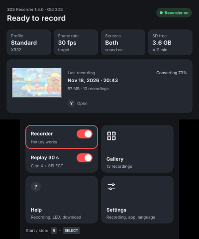
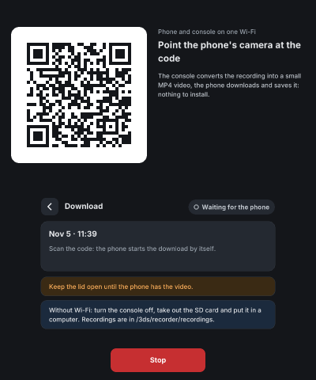
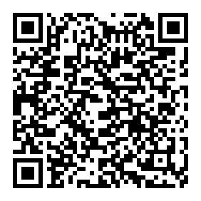
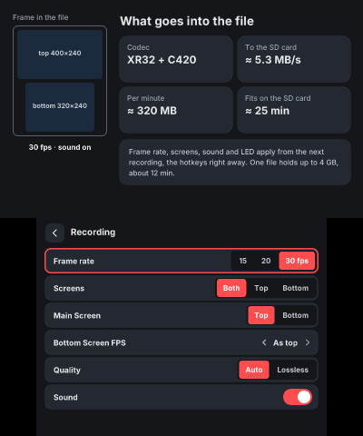
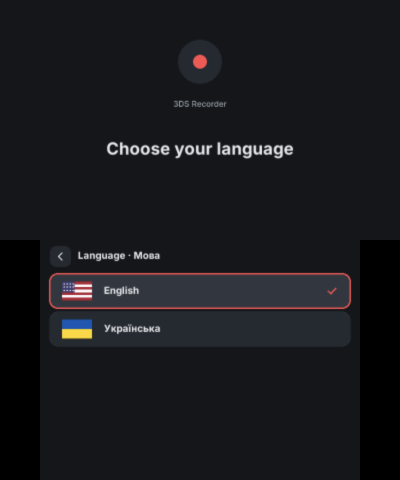

<h1 align="center">3DS Recorder</h1>

  Record everything on your Nintendo 3DS — games, the HOME Menu and apps, both screens with sound. 
  Made in Ukraine 🇺🇦

  <b>English</b> · <a href="README.uk.md"><b>Українська</b></a>

https://github.com/user-attachments/assets/d1b3c15e-1c8d-4e66-b38b-ae4036cdea3c

Every clip was recorded on a real 3DS with 3DS Recorder itself. Also on <a href="https://youtu.be/zydtKqTY6Zo">YouTube</a>. 
3D models (CC BY 4.0, Sketchfab): “Nintendo 3DS” by Broeach8972, “Apple iPhone 13 Pro Max” by DatSketch. Music: “High Energy Adventure Theme” by srg774 (CC0).

  
  
  

## Demo

<!-- the demo video: docs/demo.mp4 (kept locally), uploaded as a GitHub attachment -->

https://github.com/user-attachments/assets/122e7c76-d4c6-4f60-9426-aeed7d322776

*Recorded on an Old 3DS with 3DS Recorder itself: Mario Kart 7, both screens with sound — the MP4 the console made,
as it is (400 × 480), only cut shorter.* More, as they came out:
[Old 3DS — HOME Menu and a Mario Kart 7 race](https://github.com/BolgarMaxym97/3ds-recorder/releases/download/v1.0.0/demo-old3ds-mk7.mp4) (2 min 19 s, 32 MB) ·
[New 3DS XL — Resident Evil Revelations](https://github.com/BolgarMaxym97/3ds-recorder/releases/download/v1.0.0/demo-new3ds-re-revelations.mp4) (55 s, 11 MB).

## What it does

- Records the **whole console**: any game, the HOME Menu, system apps — both screens (or one) with the game sound,
  up to 30 fps on an Old 3DS.
- One button combination starts and stops it, anywhere. The app can be closed: the recorder runs in the background.
- **Replay** keeps the last moments all the time (15 s to 5 min), so something that already happened can still be
  saved as a clip.
- Keeps **the buttons you press** with each recording: the video can show them beside the bottom screen.
- The console turns each recording into a small **MP4**, and you get it on your phone by scanning a QR code. No PC,
  no capture card.

## What you need

- A Nintendo 3DS, 3DS XL, 2DS, New 3DS, New 3DS XL or New 2DS XL with **Luma3DS** custom firmware.
- **FBI** to install the `.cia` (or the Homebrew Launcher for the `.3dsx`).
- Free SD space: up to **~320 MB a minute** in 3D games (both screens, 30 fps; menus and 2D games take much less).
  The MP4 is about 25 MB a minute. Replay needs 700 MB free for 30 s (up to 5.2 GB for 5 min).
- For the phone: the phone and the console on the same Wi-Fi (the console uses 2.4 GHz).

## Install

1. Download `3ds-recorder.cia` (or `.3dsx`) from the [latest release](https://github.com/BolgarMaxym97/3ds-recorder/releases/latest).
2. Copy it to the SD card. Install the `.cia` with FBI (SD → the file → **Install CIA**); the `.3dsx` goes in `/3ds/`.
3. Turn the console on holding **SELECT**. In the Luma menu turn on **Enable loading external FIRMs and modules**
   and save with **START**.
4. Open **3DS Recorder**, choose your language and read the short guide. The recorder starts by itself: the LED
   glows blue for a moment.

**Without a PC:** in FBI choose **Remote Install → Scan QR Code** and scan this code. It always installs the latest
release.

**To update,** open Settings → App → **Updates** and press **Update** (from 1.7.0 on; the app also checks by itself
when it opens with Wi-Fi, and a dot on Settings shows a new version). Before 1.7.0: install the new `.cia` over the old
one (or replace the `.3dsx`) and open the app. Settings and recordings stay.

## How to use

| | |
|---|---|
| **Record** | **R + SELECT** anywhere starts a recording, the same again saves it. |
| **Replay** | Switch **Replay** on in the Recorder tile; in a game, **X + SELECT** saves the last 30 seconds as a clip (or what you set in Settings → Recorder → Replay Length: 15 s to 5 min). |
| **Watch** | Gallery → **A**. |
| **To the phone** | Gallery → **Y** on a recording, scan the QR code with the phone's camera, tap **Save the video**. iPhone and Android, nothing to install. |
| **From the SD card** | `/3ds/recorder/recordings/`: an `.mp4` next to each converted `.r3d`. Only an `.r3d`? Drop it on the [converter page](https://bolgarmaxym97.github.io/3ds-recorder/) — the browser makes the MP4, nothing is uploaded. |

**On a computer, in high quality** — [two ways](docs/pc-converter.md): the [converter page](https://bolgarmaxym97.github.io/3ds-recorder/) (nothing to
install: 1×–3× sharp pixels, top / bottom / side by side, for YouTube or for editing), or
[r3d2video](docs/pc-converter.md) for DNxHR, lossless files and one file per screen (Windows zip with each release;
by [noctis1008-wq](https://github.com/noctis1008-wq)).

**The LED:** blue for a moment — ready · red, breathing — recording · faint blue — Replay is on · green twice — saved ·
red three times — something went wrong (usually a full SD card), open the app to see why.

**After each power-on, open the app once** to start the recorder again — or turn on Settings → Recorder →
**Launch On Startup** and it starts with the console (needs Luma's **Enable game patching** too).

## Settings

  
  
  

- **Recording:** frame rate (15 / 20 / 30 fps), screens (both, top, bottom), Main Screen (the one the game is played
  on keeps its frames first), Bottom Screen FPS (record a still bottom screen less often, so the top one gets more of
  the console), quality, sound.
- **Recorder:** the two hotkeys (recording, Replay clip), Replay Length, Record Buttons, the LED, Launch On Startup.
- **App:** Convert To MP4 (automatically, or only the recording you download), Buttons In Video, Work With Lid Closed,
  Share Statistics, Test SD Card (is the card fast enough?), Uninstall recorder.
- **Language:** English, Українська, Deutsch, Español, Français, Italiano, Português (Brazil), 日本語, 简体中文,
  繁體中文. The first run offers the console's own language; the phone page follows the app's language.

**Quality: Auto** stores a picture that changes all over (a 3D game in motion) the way video does, so both screens keep
up to 30 fps on an Old 3DS; menus and 2D stay exact. **Lossless** keeps every frame exact, but in 3D games the SD card
cannot take every frame.

## Good to know

- **DS and GBA games can't be recorded** — they run in a separate mode of the console.
- Leaving System Settings or starting a DS / GBA game **restarts the console**, and turning it off stops the recorder
  too: the recording is saved there.
- **Applets** (Internet Browser, Friend List…) need the recorder's memory: the recording is saved first and goes on
  when the applet closes.
- **Closing the lid** pauses a recording; the parts become one recording again in the app. While the app converts or
  saves clips, the lid can be closed: the work goes on, then the console sleeps.
- **Games that need extra memory on an Old 3DS** (Smash Bros, Pokémon Sun / Moon, Monster Hunter…) need Luma's
  **Plugin Loader** on for the recorder to come back inside them, and record fewer frames there. Your own plugins for
  such a game stay.
- Long recordings continue in a new file every 4 GB or every hour (FAT32).
- **Stop the recorder while you stream with NTR**: the two compete for the console.

More: [the guide](docs/guide.md) — Replay, Launch On Startup, applets, extended-memory games, plugin menus, limits.

## Problems and feedback

Tested on an Old 3DS and a New 3DS XL with Luma3DS 13.5, but not on every console, game and SD card. If something
goes wrong, open an [issue](../../issues/new): what you did, what happened, the console and the game, and the logs
(the phone page → **Log for the developer**, or `/3ds/recorder/app.log` and `recorder.log`).

**A game does not start or freezes with the recorder?** Switch **Recorder** off on the app's panel and play without
it — and please tell us in an issue.

**"Could not start the recorder (start, C8804478)"?** Luma3DS looks for the recorder where it was itself started
from. Started from the console's memory (CTRNAND), it does not see the one on the SD card: copy `boot.firm` from the
[latest Luma3DS](https://github.com/LumaTeam/Luma3DS/releases/latest) to the root of the SD card and restart.

**Anonymous statistics:** with Settings → App → **Share Statistics** on (the default), the app sends the new lines of
its logs when it opens with Wi-Fi, so we see how it works on consoles we can't test. No IP address, name or Friend Code.
[What exactly is sent](docs/privacy.md).

## Remove

Settings → App → **Uninstall recorder**: the recorder, its settings, logs and the app go; recordings stay unless you
tick the box. Luma settings are not changed.

## Building

[docs/building.md](docs/building.md) — a Docker image with devkitARM builds everything.

## Thanks

[Luma3DS](https://github.com/LumaTeam/Luma3DS), [devkitPro / libctru / citro2d](https://devkitpro.org),
[minih264](https://github.com/lieff/minih264), [vo-aacenc](https://github.com/mstorsjo/vo-aacenc) (Apache 2.0),
[QR Code generator](https://www.nayuki.io/page/qr-code-generator-library) (MIT),
[mp4-muxer](https://github.com/Vanilagy/mp4-muxer) (MIT), [Inter](https://rsms.me/inter/) and
[Noto Sans JP / SC / TC](https://fonts.google.com/noto) fonts (SIL OFL).
Their licenses are next to their code in `third_party/`, `web/vendor/` and `app/assets/fonts/`.
From the community: [r3d2video](docs/pc-converter.md) by [noctis1008-wq](https://github.com/noctis1008-wq); ideas from
the forks of [Yu08083](https://github.com/Yu08083/3ds-recorder) (plugin menus, sharper still pictures in the MP4).
Developed with the help of [Claude Code](https://claude.com/claude-code) (Anthropic).

## Support the project

3DS Recorder is free and stays free. If it is useful to you, you can support its development:
[Ko-fi](https://ko-fi.com/maksymbolhar) · [Monobank jar](https://send.monobank.ua/jar/9jJDGho7H8).
A star on GitHub and a word about bugs in the [issues](../../issues) help too.

## License

[MIT](LICENSE). The third-party parts keep their own licenses.
