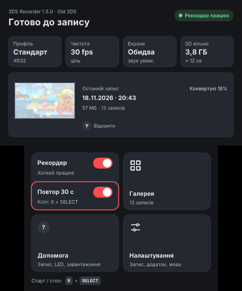
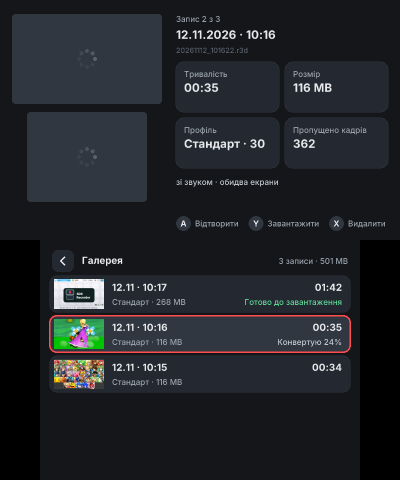
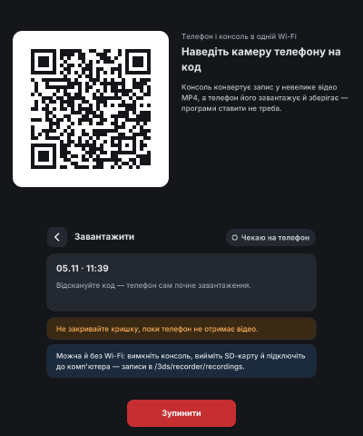
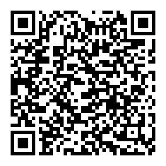
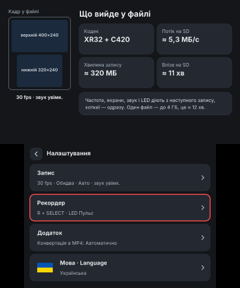
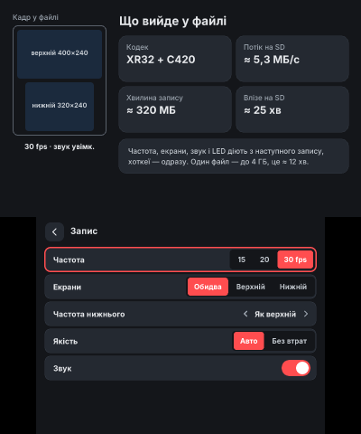
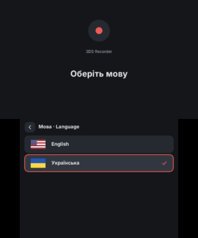

<h1 align="center">3DS Recorder</h1>

  Записує все на Nintendo 3DS — ігри, меню HOME і програми, обидва екрани зі звуком. 
  Зроблено в Україні 🇺🇦

  <a href="README.md"><b>English</b></a> · <b>Українська</b>

https://github.com/user-attachments/assets/d1b3c15e-1c8d-4e66-b38b-ae4036cdea3c

Усі кліпи записано на справжній 3DS самим 3DS Recorder. Також на <a href="https://youtu.be/zydtKqTY6Zo">YouTube</a>. 
3D-моделі (CC BY 4.0, Sketchfab): «Nintendo 3DS» — Broeach8972, «Apple iPhone 13 Pro Max» — DatSketch. Музика: «High Energy Adventure Theme» — srg774 (CC0).

  
  
  

## Демо

https://github.com/user-attachments/assets/122e7c76-d4c6-4f60-9426-aeed7d322776

*Записано на Old 3DS самим 3DS Recorder: Mario Kart 7, обидва екрани зі звуком — MP4, який зробила консоль, як є
(400 × 480), лише обрізаний.* Ще, як вони вийшли:
[Old 3DS — меню HOME і заїзд у Mario Kart 7](https://github.com/BolgarMaxym97/3ds-recorder/releases/download/v1.0.0/demo-old3ds-mk7.mp4) (2 хв 19 с, 32 MB) ·
[New 3DS XL — Resident Evil Revelations](https://github.com/BolgarMaxym97/3ds-recorder/releases/download/v1.0.0/demo-new3ds-re-revelations.mp4) (55 с, 11 MB).

## Що він уміє

- Записує **всю консоль**: будь-яку гру, меню HOME, системні програми — обидва екрани (або один) зі звуком гри,
  до 30 fps на Old 3DS.
- Одна комбінація кнопок починає і зупиняє запис будь-де. Додаток можна закрити: рекордер працює у фоні.
- **Повтор** постійно тримає останні моменти (від 15 с до 5 хв), тож те, що вже сталося, можна зберегти кліпом.
- Зберігає **натиснуті кнопки** з кожним записом: відео може показати їх збоку від нижнього екрана.
- Консоль сама робить із кожного запису невелике **MP4**, а на телефон його можна забрати, відсканувавши QR-код.
  Без комп'ютера і карти захоплення.

## Що потрібно

- Nintendo 3DS, 3DS XL, 2DS, New 3DS, New 3DS XL або New 2DS XL з кастомною прошивкою **Luma3DS**.
- **FBI**, щоб встановити `.cia` (або Homebrew Launcher для `.3dsx`).
- Місце на SD: до **~320 MB на хвилину** у 3D-іграх (обидва екрани, 30 fps; меню і 2D-ігри — набагато менше).
  MP4 — близько 25 MB на хвилину. Для Повтору треба 700 MB вільного місця на 30 с (до 5,2 GB на 5 хв).
- Для телефона: телефон і консоль в одній Wi-Fi мережі (консоль працює на 2.4 GHz).

## Встановлення

1. Завантажте `3ds-recorder.cia` (або `.3dsx`) з [останнього релізу](https://github.com/BolgarMaxym97/3ds-recorder/releases/latest).
2. Скопіюйте на SD-картку. `.cia` встановіть через FBI (SD → файл → **Install CIA**); `.3dsx` покладіть у `/3ds/`.
3. Увімкніть консоль із затиснутою **SELECT**. У меню Luma увімкніть **Enable loading external FIRMs and modules**
   і збережіть кнопкою **START**.
4. Відкрийте **3DS Recorder**, виберіть мову і прочитайте короткий гайд. Рекордер запуститься сам: LED на мить
   засвітиться синім.

**Без ПК:** у FBI виберіть **Remote Install → Scan QR Code** і зіскануйте цей код. Він завжди встановлює останній
реліз.

**Щоб оновити,** відкрийте Налаштування → Додаток → **Оновлення** і натисніть **Оновити** (з 1.7.0; додаток і сам
перевіряє, коли відкривається з Wi-Fi, а крапка на «Налаштуваннях» показує нову версію). До 1.7.0: встановіть новий
`.cia` поверх старого (або замініть `.3dsx`) і відкрийте додаток. Налаштування і записи лишаються.

## Як користуватися

| | |
|---|---|
| **Запис** | **R + SELECT** будь-де починає запис, ще раз — зберігає. |
| **Повтор** | Увімкніть **Повтор** у плитці «Рекордер»; у грі **X + SELECT** зберігає останні 30 секунд кліпом (або скільки задано в Налаштування → Рекордер → Тривалість повтору: від 15 с до 5 хв). |
| **Перегляд** | Галерея → **A**. |
| **На телефон** | Галерея → **Y** на записі, відскануйте QR-код камерою телефона, натисніть **Зберегти відео**. iPhone і Android, нічого ставити не треба. |
| **З SD-картки** | `/3ds/recorder/recordings/`: поруч зі сконвертованим `.r3d` лежить `.mp4`. Лише `.r3d`? Перетягніть його на [сторінку конвертера](https://bolgarmaxym97.github.io/3ds-recorder/) — MP4 зробить браузер, нічого не вивантажується. |

**На комп'ютері, у високій якості** — [два шляхи](docs/pc-converter.uk.md): [сторінка конвертера](https://bolgarmaxym97.github.io/3ds-recorder/) (нічого
не треба встановлювати: 1×–3× з чіткими пікселями, верхній / нижній / поруч, для YouTube чи для монтажу) або
[r3d2video](docs/pc-converter.uk.md) для DNxHR, файлів без втрат і окремого файлу для кожного екрана (zip для Windows
у кожному релізі; автор — [noctis1008-wq](https://github.com/noctis1008-wq)).

**LED:** синій на мить — готово · червоний «дихає» — іде запис · слабкий синій — Повтор увімкнено · зелений двічі —
збережено · червоний тричі — щось не так (найчастіше заповнена SD-картка), відкрийте додаток, щоб побачити причину.

**Після кожного ввімкнення консолі відкрийте додаток один раз**, щоб рекордер запустився знову — або увімкніть
Налаштування → Рекордер → **Запуск з консоллю**, і він стартуватиме разом з консоллю (потрібна ще опція Luma
**Enable game patching**).

## Налаштування

  
  
  

- **Запис:** частота (15 / 20 / 30 fps), екрани (обидва, верхній, нижній), головний екран (той, на якому грають,
  отримує кадри першим), частота нижнього (нерухомий нижній екран знімається рідше, і верхньому дістається більше
  ресурсів консолі), якість, звук.
- **Рекордер:** два хоткеї (запис, кліп Повтору), тривалість повтору, запис кнопок, LED, запуск з консоллю.
- **Додаток:** конвертація в MP4 (автоматично або лише запис, який ви завантажуєте), кнопки у відео, робота з
  закритою кришкою, «Ділитись статистикою», тест SD-карти (чи вистачає її швидкості?), видалення рекордера.
- **Мова:** English, Українська, Deutsch, Español, Français, Italiano, Português (Бразилія), 日本語, 简体中文,
  繁體中文. При першому запуску пропонується мова консолі; сторінка на телефоні — мовою додатка.

**Якість «Авто»** зберігає картинку, яка змінюється вся (3D-гра в русі), як відео, тож на Old 3DS обидва екрани
тримають до 30 fps; меню і 2D лишаються точними. **«Без втрат»** зберігає кожен кадр точно, але в 3D-іграх SD-картка
не встигає за всіма кадрами.

## Варто знати

- **DS- і GBA-ігри записати не можна** — вони працюють в окремому режимі консолі.
- Вихід з Налаштувань консолі чи запуск DS- / GBA-гри **перезапускає консоль**, а вимкнення теж зупиняє рекордер:
  запис на цьому зберігається.
- **Аплетам** (Інтернет-браузер, Список друзів…) потрібна пам'ять рекордера: запис спершу зберігається і
  продовжується, коли аплет закриється.
- **Закрита кришка** ставить запис на паузу; частини знову стають одним записом у додатку. Поки додаток конвертує чи
  зберігає кліпи, кришку можна закрити: робота піде далі, а потім консоль засне.
- **Ігри, яким на Old 3DS треба більше пам'яті** (Smash Bros, Pokémon Sun / Moon, Monster Hunter…): щоб рекордер
  повертався в них, у Luma має бути ввімкнений **Plugin Loader**; кадрів там менше. Ваші плагіни для такої гри
  лишаються.
- Довгі записи продовжуються в новому файлі кожні 4 GB або щогодини (FAT32).
- **Зупиняйте рекордер на час трансляції через NTR**: вони змагаються за ресурси консолі.

Більше — у [посібнику](docs/guide.uk.md): Повтор, запуск з консоллю, аплети, ігри з додатковою пам'яттю, меню плагінів, обмеження.

## Проблеми і відгуки

Перевірено на Old 3DS і New 3DS XL з Luma3DS 13.5, але не на кожній консолі, грі й SD-картці. Якщо щось пішло не так,
створіть [issue](../../issues/new): що робили, що сталося, консоль і гра, і журнали (сторінка в телефоні →
**Журнал для розробника**, або `/3ds/recorder/app.log` і `recorder.log`).

**Гра не запускається або зависає з рекордером?** Вимкніть **Рекордер** на пульті додатка й грайте без нього — і,
будь ласка, напишіть про це в issue.

**«Не вдалося запустити рекордер (start, C8804478)»?** Luma3DS шукає рекордер там, звідки запустилася сама.
Запущена з пам'яті консолі (CTRNAND), вона не бачить рекордер на SD-картці: скопіюйте `boot.firm` з
[останнього випуску Luma3DS](https://github.com/LumaTeam/Luma3DS/releases/latest) у корінь SD-картки й перезапустіть консоль.

**Анонімна статистика:** якщо в Налаштування → Додаток увімкнено **Ділитись статистикою** (так спершу), додаток,
відкриваючись із Wi-Fi, надсилає нові рядки своїх журналів, щоб ми бачили, як він працює на консолях, яких у нас
немає. Без IP-адреси, імені й Friend Code. [Що саме надсилається](docs/privacy.uk.md).

## Видалення

Налаштування → Додаток → **Видалити рекордер**: зникають рекордер, його налаштування, журнали і сам додаток; записи
лишаються, якщо не поставити позначку. Налаштування Luma не змінюються.

## Збірка

[docs/building.md](docs/building.md) (англійською) — усе збирається в Docker-образі з devkitARM.

## Подяки

[Luma3DS](https://github.com/LumaTeam/Luma3DS), [devkitPro / libctru / citro2d](https://devkitpro.org),
[minih264](https://github.com/lieff/minih264), [vo-aacenc](https://github.com/mstorsjo/vo-aacenc) (Apache 2.0),
[QR Code generator](https://www.nayuki.io/page/qr-code-generator-library) (MIT),
[mp4-muxer](https://github.com/Vanilagy/mp4-muxer) (MIT), шрифти [Inter](https://rsms.me/inter/) і
[Noto Sans JP / SC / TC](https://fonts.google.com/noto) (SIL OFL).
Їхні ліцензії лежать поруч з їхнім кодом у `third_party/`, `web/vendor/` і `app/assets/fonts/`.
Від спільноти: [r3d2video](docs/pc-converter.uk.md) від [noctis1008-wq](https://github.com/noctis1008-wq); ідеї з
форку [Yu08083](https://github.com/Yu08083/3ds-recorder) (меню плагінів, чіткі нерухомі кадри в MP4).
Розроблено за допомогою [Claude Code](https://claude.com/claude-code) (Anthropic).

## Підтримати проєкт

3DS Recorder безкоштовний і таким лишиться. Якщо він вам корисний, можна підтримати розробку:
[Ko-fi](https://ko-fi.com/maksymbolhar) · [банка Monobank](https://send.monobank.ua/jar/9jJDGho7H8).
Зірка на GitHub і повідомлення про помилки в [issues](../../issues) теж допомагають.

## Ліцензія

[MIT](LICENSE). Сторонні частини мають власні ліцензії.
