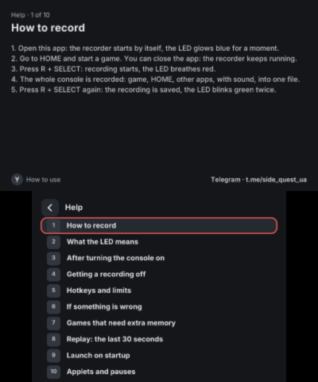
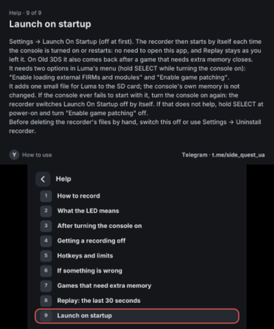

# 3DS Recorder — the guide

[← README](../README.md) · [Українська](guide.uk.md)

The details behind the short README: how each feature works, what it costs, and the limits.

  
  

The same topics are in the app: **Help** on the panel.

## Replay — save what just happened

- Switch **Replay** on in the Recorder tile. While a game or another program runs, the recorder keeps its last
  seconds all the time (the LED glows faint blue): 30 at first, Settings → Recorder → **Replay Length** picks 15 s,
  30 s, 1, 2 or 5 min. It begins about 15 seconds after a game starts, so the game
  loads undisturbed.
- **X + SELECT** saves them as a clip: the LED blinks green twice. Red three times instead: Replay is not running
  there (it is off, or the game started less than 15 seconds ago).
- A clip is that long, a few seconds more at times. It is saved at once and becomes a recording in the Gallery, marked
  *Replay*, the next time 3DS Recorder is open — keep the app open until *Saving clip* is gone.
- It works while a game or another program is open, not in the HOME Menu alone. It pauses while a normal recording
  runs (R + SELECT still works as usual), while 3DS Recorder or an applet is open and while the lid is closed.
- It writes to the SD card all the time — several GB an hour in a 3D game, which wears the card — and keeps two files on
  the card while it is on: 2 × 128 MB for 15 s, 2 × 256 MB for 30 s, up to 2 × 2.5 GB for 5 min. To switch it on, the
  card needs that and ~190 MB more free (700 MB for 30 s, 5.2 GB for 5 min). A new length applies when Replay starts
  again. In a 30-minute test on an Old 3DS the battery ran down as fast with it as without it.
- It is off again after the console has been turned off: switch it on for a play session. With Launch On Startup it
  stays as you left it.
- On an Old 3DS it runs in games that need extra memory too, with fewer frames a second there.

## Launch On Startup

Settings → Recorder → **Launch On Startup** (off at first): the recorder starts with the console each time it is
turned on or restarts, with Replay as you left it, and you never have to open the app for it.

- It needs two Luma options (hold **SELECT** while turning the console on): **Enable loading external FIRMs and
  modules** and **Enable game patching**. The app says so if one is off.
- It adds one small file for Luma to the SD card (`/luma/titles/<system title>/exheader.bin`), which makes the console
  start the recorder together with its own system modules. Nothing in the console's own memory is changed. Needs
  Luma3DS 13.0 or newer.
- Before it puts the file there, the recorder checks on your console that a missing recorder cannot stop the console
  from starting, and afterwards that Luma really uses the file. If either check fails it changes nothing and tells you.
- If the console ever does not get to the HOME Menu with it, turn the console on again: the recorder notices the failed
  start and switches Launch On Startup off by itself. If even that does not help, hold **SELECT** while turning the
  console on and turn **Enable game patching** off.
- Switching it off, or Uninstall recorder, removes the file. Before deleting the recorder's files by hand, switch it
  off first.
- Tested on an Old 3DS; on a New 3DS the same checks run, reports are welcome.

## Getting recordings off the console

- **To a phone:** Gallery → **Y**, scan the QR code, tap **Save the video**. While the app is open, the console turns
  each recording into a small MP4 in the background (Settings → App → **Convert To MP4: Automatically**), so the phone
  gets it quickly over the 3DS Wi-Fi.
- **Convert To MP4: On Download** leaves recordings as `.r3d` and converts only the one you download. Pick it if you
  copy recordings to a computer: the [converter page](https://bolgarmaxym97.github.io/3ds-recorder/) makes the MP4 in
  the browser much faster than the console, and the file is not uploaded anywhere.
- `.r3d` is this recorder's own format, not RED's: video editors do not open it, use the MP4.
- **On a computer, in high quality:** the [converter page](https://bolgarmaxym97.github.io/3ds-recorder/) also makes bigger, sharper videos (2× or 3×), one
  screen or both side by side, for YouTube or for editing. Need DNxHR, a lossless file or one file per screen: the
  r3d2video program. Both ways: [pc-converter.md](pc-converter.md).
- **The buttons you press** are kept with each recording (Settings → Recorder → **Record Buttons**, on at first; a few
  KB a minute). They are drawn only where you ask: **X** in the player, Settings → App → **Buttons In Video** for the
  console's MP4s, **Buttons** on the converter page, `--inputs` in r3d2video. With both screens they sit in the strips
  beside the bottom screen and cover none of the game; with one screen, in a small panel in a corner. A touch is a ring
  where you touched.
- **A part only:** on the converter page, play the video it made, pause where the part starts → **Start here**, where
  it ends → **End here**, then **Make this part**. **Discord** makes a video under 10 MB (Discord's limit without Nitro).
- **Work With Lid Closed** (Settings → App, on at first): while the app converts, joins recordings or saves Replay
  clips, close the lid — the screens go dark, the work goes on, and the console sleeps once everything is done (or when
  the battery is nearly empty).

## Recording settings

- **Main Screen:** with both screens recorded, the one the game is played on keeps its frames first; the other one
  gives way when the console or the SD card falls behind (down to 10 frames a second).
  **Bottom** for games played on the touch screen; Bottom Screen FPS below then sets the top screen's rate.
- **Bottom Screen FPS:** with both screens recorded, the bottom one can be captured less often (15, 10, 5 or 1 fps).
  A still menu there then leaves more of the console to the top screen — smoother on an Old 3DS. A game played on the
  bottom screen looks choppy at 5 or 1 fps. A screen that does not change already costs almost nothing on the SD card;
  this saves processor time, not space.
- **Test SD Card** (Settings → App): writes 96 MB the way the recorder does (20–40 s) and tells how fast the card is
  and what that is enough for. Both screens of a 3D game at 30 fps need about 5.4 MB/s on an Old 3DS.
- **Quality — Auto:** a picture that changes all over (a 3D game in motion) is stored the way video is, colour at half
  the resolution, so both screens keep up to 30 frames a second on an Old 3DS; menus, 2D games and still pictures stay
  exact. **Lossless** keeps every frame exact; in 3D games the SD card then cannot take every frame.

## When the console restarts or pauses

- **Leaving System Settings, starting a DS or GBA game, or turning the console off restarts the console.** The
  recording is saved and stops there; open 3DS Recorder again afterwards (with Launch On Startup the recorder is back
  by itself). The app tells you what happened.
- **Applets** (Internet Browser, Game Notes, Friend List, …) need the memory the recorder holds: when one opens during
  a recording, the recording is saved first and gives its memory back. On an Old 3DS it goes on next to a small applet
  at a lower frame rate; nothing is recorded next to the Internet Browser (it takes nearly all of the memory), and on a
  New 3DS nothing next to any applet. When the applet closes, the recording goes on, and Replay starts again.
- **Closing the lid** saves the recording; it goes on when you open the lid.
- **One recording, not many:** when the recorder pauses a recording by itself (an applet, the lid), the parts become
  one recording again while 3DS Recorder is open, also with the lid closed (*Joining recordings*); a pause shows as
  half a second of the last picture. Recordings you stop yourself stay separate.
- **If the power is cut** (battery, crash), the recording is recovered the next time you open the app.

## Games that need extra memory (Old 3DS)

Smash Bros, Pokémon Sun / Moon and Ultra Sun / Ultra Moon, Super Mario Maker and Monster Hunter restart an Old 3DS when
they start and when they close. A New 3DS does not restart for them.

- If the recorder runs, it comes back inside the game by itself and the recording goes on in a new file: right before
  the restart it leaves Luma's plugin loader a one-time order to load a tiny launcher plugin (about 1 KB) into that
  game, which starts the recorder again and does nothing else.
- **Luma's Plugin Loader must be on for this** (Rosalina menu, L + ↓ + SELECT → Plugin Loader). With Launch On Startup
  the recorder turns it on for that one game and off again afterwards.
- The game gets 2 MB less memory, the recorder keeps its buffers (Replay too) in those 2 MB, and the video is less
  smooth there (about 12 frames a second in Pokémon Ultra Moon, 18 in Smash Bros). Recording only the top screen
  (Settings → Recording → Screens → Top) makes it smoother.
- When such a game closes, the recording is saved; open 3DS Recorder to record again, or use Launch On Startup.
- **A game with its own plugin** (a `.3gx` in `/luma/plugins/<title id>/`, or `/luma/plugins/default.3gx`): the
  recorder leaves your plugin in place and loads none of its own. It still comes back in that game when it starts with
  the console (Launch On Startup), with fewer frames, as in the next point.
- Some games need every bit of that memory and crash with 2 MB less (Monster Hunter 4G, X and XX): the recorder loads
  no plugin into them, so they run as without it (unless Launch On Startup brought the recorder back with the
  console: it then records and keeps Replay in a smaller buffer, paused while the HOME Menu is open). A game that goes
  down within 30 s of the plugin is added to `/3ds/recorder/no_launcher.txt` by itself; delete its line to try again.

## Limits

- **Plugin menus:** CTRPluginFramework menus are recorded. A 3GX plugin that draws its own screens elsewhere leaves
  the game's last picture in the video while its menu is open. If a game with a plugin crashes while its menu is
  recorded, add the line `ctrpf_capture=off` to `/3ds/recorder/config.ini`: the menu is then left out of the video.
- **NTR streaming** competes with the recorder for the console: stop the recorder (or turn off Launch On Startup)
  while you stream with NTR.
- **DS and GBA games can't be recorded:** they run in a separate mode of the console.
- **Long recordings** continue in a new file every 4 GB or every hour (a 1–2 second gap): the SD card's FAT32 limit.
- **Fast 3D scenes on a slow SD card** may be recorded at a lower frame rate for a moment.
- **Games that use nearly all of an Old 3DS's processor** (Yo-kai Watch, for one) leave the recorder little time:
  frames are thinned out evenly, the bottom screen's first (about 28 frames a second on top and 10 below there), and
  the game itself is not slowed.
- On a New 3DS, the few games that use the **800-pixel wide top screen** are recorded at 400 pixels: the whole picture,
  each two columns made one (a little softer).

## Removing it

Settings → App → **Uninstall recorder** removes the recorder, its settings and logs, and the app itself. Recordings
stay unless you tick the box. The Launch On Startup file goes too, and so does the statistics ID. Luma settings are not
changed.
