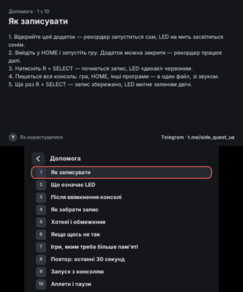
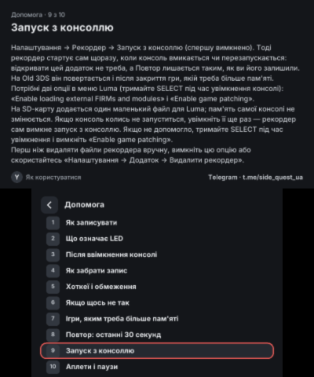

# 3DS Recorder — посібник

[← README](../README.uk.md) · [English](guide.md)

Подробиці до короткого README: як працює кожна функція, чого вона коштує і які є обмеження.

  
  

Ті самі теми є в додатку: **Допомога** на пульті.

## Повтор — останні 30 секунд

- Увімкніть **Повтор 30 с** у плитці «Рекордер». Поки запущено гру чи іншу програму, рекордер постійно тримає її
  останні 30 секунд (LED слабко світиться синім). Він починає приблизно через 15 секунд після запуску гри, щоб не
  заважати їй завантажитись.
- **X + SELECT** зберігає їх кліпом: LED двічі мигне зеленим. Червоний тричі — Повтор там не працює (його вимкнено
  або гра стартувала менш ніж 15 секунд тому).
- Кліп — це 30 секунд, часом на кілька більше. Він зберігається одразу, а записом у Галереї з позначкою «Повтор»
  стає, коли наступного разу відкрито 3DS Recorder — не закривайте додаток, доки не зникне «Зберігаю кліп».
- Працює, поки відкрито гру чи іншу програму, не в самому меню HOME. Стає на паузу, поки йде звичайний запис
  (R + SELECT працює як завжди), поки відкрито 3DS Recorder чи аплет і поки закрита кришка.
- Постійно пише на SD-картку — кілька ГБ за годину в 3D-грі, і картка від цього зношується — і займає на ній 512 МБ,
  поки ввімкнений. У 30-хвилинному тесті на Old 3DS батарея сідала з ним так само, як без нього.
- Після вимкнення консолі знову вимкнений: вмикайте його на ігрову сесію. Із запуском з консоллю він лишається таким,
  як ви його залишили.
- На Old 3DS працює і в іграх, яким треба більше пам'яті, але кадрів за секунду там менше.

## Запуск з консоллю

Налаштування → Рекордер → **Запуск з консоллю** (спершу вимкнено): рекордер стартує разом з консоллю щоразу, коли вона
вмикається чи перезапускається, Повтор лишається таким, як ви його залишили, і відкривати додаток для цього не треба.

- Потрібні дві опції Luma (тримайте **SELECT** під час увімкнення консолі): **Enable loading external FIRMs and
  modules** і **Enable game patching**. Якщо одна вимкнена, додаток про це скаже.
- На SD-картку додається один маленький файл для Luma (`/luma/titles/<системний титул>/exheader.bin`), через який
  консоль запускає рекордер разом зі своїми системними модулями. У пам'яті самої консолі нічого не змінюється.
  Потрібна Luma3DS 13.0 або новіша.
- Перш ніж покласти файл, рекордер перевіряє на вашій консолі, що відсутній рекордер не завадить їй запуститися, а
  після — що Luma справді використовує файл. Якщо хоч одна перевірка не проходить, він нічого не змінює і каже про це.
- Якщо консоль колись не дійде з ним до меню HOME, увімкніть її ще раз: рекордер помітить невдалий старт і сам вимкне
  запуск з консоллю. Якщо й це не допомогло, тримайте **SELECT** під час увімкнення і вимкніть **Enable game
  patching**.
- Вимкнення або «Видалити рекордер» прибирає файл. Перш ніж видаляти файли рекордера вручну, спершу вимкніть цю опцію.
- Перевірено на Old 3DS; на New 3DS виконуються ті самі перевірки — відгуки вітаються.

## Як забрати записи з консолі

- **На телефон:** Галерея → **Y**, відскануйте QR-код, натисніть **Зберегти відео**. Поки додаток відкритий, консоль
  у фоні робить із кожного запису невелике MP4 (Налаштування → Додаток → **Конвертація в MP4: Автоматично**), тож
  телефон швидко отримує його через Wi-Fi 3DS.
- **Конвертація в MP4: При завантаженні** лишає записи в `.r3d` і конвертує лише той, який ви завантажуєте. Оберіть її,
  якщо копіюєте записи на комп'ютер: [сторінка конвертера](https://bolgarmaxym97.github.io/3ds-recorder/) робить MP4 у
  браузері значно швидше за консоль, і файл нікуди не вивантажується.
- `.r3d` — власний формат цього рекордера, не RED: відеоредактори його не відкривають, беріть MP4.
- **Робота з закритою кришкою** (Налаштування → Додаток, спершу ввімкнено): поки додаток конвертує, склеює записи чи
  зберігає кліпи Повтору, закрийте кришку — екрани згаснуть, робота піде далі, а коли все буде готово (або батарея
  майже сяде), консоль засне.

## Налаштування запису

- **Частота нижнього:** коли записуються обидва екрани, нижній можна знімати рідше (15, 10, 5 чи 1 fps). Тоді
  нерухоме меню на ньому лишає більше ресурсів консолі верхньому екрану — на Old 3DS плавніше. Гра, в яку грають на
  нижньому екрані, на 5 чи 1 fps буде уривчастою. Екран, що не змінюється, і так майже не займає місця на SD-картці:
  це економить процесор, а не місце.
- **Якість — Авто:** картинка, яка змінюється вся (3D-гра в русі), зберігається як у відео — колір із половинною
  роздільністю, тому на Old 3DS обидва екрани тримають до 30 кадрів на секунду; меню, 2D-ігри й нерухомі картинки
  лишаються точними. **Без втрат** зберігає кожен кадр точно; у 3D-іграх SD-картка тоді не встигає за всіма кадрами.

## Коли консоль перезапускається чи робить паузу

- **Вихід з Налаштувань консолі, запуск DS- чи GBA-гри або вимкнення перезапускають консоль.** Запис на цьому
  зберігається і зупиняється; потім знову відкрийте 3DS Recorder (із запуском з консоллю рекордер повернеться сам).
  Додаток пояснить, що сталося.
- **Аплетам** (Інтернет-браузер, Нотатки до ігор, Список друзів, …) потрібна пам'ять, яку тримає рекордер: коли аплет
  відкривається під час запису, запис спершу зберігається і віддає пам'ять. На Old 3DS поруч із невеликим аплетом
  запис іде далі з меншою частотою кадрів; поруч з Інтернет-браузером нічого не записується (він забирає майже всю
  пам'ять), а на New 3DS — поруч із жодним аплетом. Коли аплет закривається, запис продовжується, а Повтор стартує
  знову.
- **Закрита кришка** зберігає запис, а після відкриття він продовжується.
- **Один запис, а не кілька:** коли рекордер сам ставить запис на паузу (аплет, кришка), частини знову стають одним
  записом, поки відкрито 3DS Recorder, і з закритою кришкою теж («Склеюю записи»); пауза виглядає як пів секунди
  останнього кадру. Записи, які ви зупиняєте самі, лишаються окремими.
- **Якщо зникло живлення** (батарея, збій), запис відновиться, коли ви наступного разу відкриєте додаток.

## Ігри, яким треба більше пам'яті (Old 3DS)

Smash Bros, Pokémon Sun / Moon і Ultra Sun / Ultra Moon, Super Mario Maker і Monster Hunter перезапускають Old 3DS,
коли стартують і коли закриваються. New 3DS для них не перезапускається.

- Якщо рекордер працює, він сам повертається в гру, а запис продовжується новим файлом: перед перезапуском він
  залишає завантажувачу плагінів Luma одноразову інструкцію завантажити в цю гру крихітний плагін-запускач (близько
  1 КБ), який лише знову запускає рекордер.
- **Для цього в Luma має бути ввімкнений Plugin Loader** (меню Rosalina, L + ↓ + SELECT → Plugin Loader). Із запуском
  з консоллю рекордер сам вмикає його лише на цю гру і потім вимикає.
- Грі лишається на 2 МБ менше пам'яті, рекордер тримає свої буфери (і Повтор теж) у цих 2 МБ, і відео там менш плавне
  (близько 12 кадрів на секунду в Pokémon Ultra Moon, 18 у Smash Bros). Запис лише верхнього екрана
  (Налаштування → Запис → Екрани → Верхній) робить його плавнішим.
- Коли така гра закривається, запис зберігається; щоб писати далі, відкрийте 3DS Recorder або ввімкніть запуск з
  консоллю.
- Деяким іграм потрібна вся ця пам'ять, і з 2 МБ менше вони падають (Monster Hunter 4G, X і XX): у них рекордер плагін
  не завантажує, і вони працюють як без нього (хіба що запуск з консоллю повернув рекордер: тоді він пише і тримає
  Повтор у меншому буфері, з паузою, поки відкрите меню HOME). Гру, яка впала протягом 30 с після плагіна, рекордер сам
  дописує в `/3ds/recorder/no_launcher.txt`; щоб спробувати знову, видаліть її рядок там.

## Обмеження

- **DS- і GBA-ігри записати не можна:** вони працюють в окремому режимі консолі.
- **Довгі записи** продовжуються в новому файлі кожні 4 GB або щогодини (пауза 1–2 секунди): обмеження FAT32 на
  SD-картці.
- **Швидкі 3D-сцени на повільній SD-картці** можуть на мить записатися з меншою частотою кадрів.
- **Ігри, які займають майже весь процесор Old 3DS** (наприклад, Yo-kai Watch), лишають рекордеру мало часу: кадри
  проріджуються рівномірно, спершу нижнього екрана (там близько 28 кадрів на секунду зверху і 10 знизу), а сама гра
  не сповільнюється.
- На New 3DS кілька ігор із **широким верхнім екраном 800 пікселів** записуються у 400 пікселях: лише ліва половина.

## Видалення

Налаштування → Додаток → **Видалити рекордер** видаляє рекордер, його налаштування й журнали та сам додаток. Записи
лишаються, якщо не поставити позначку. Файл запуску з консоллю теж зникає, як і ID статистики. Налаштування Luma не
змінюються.
